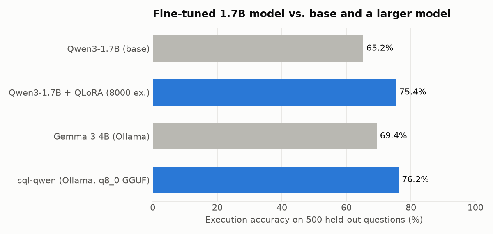
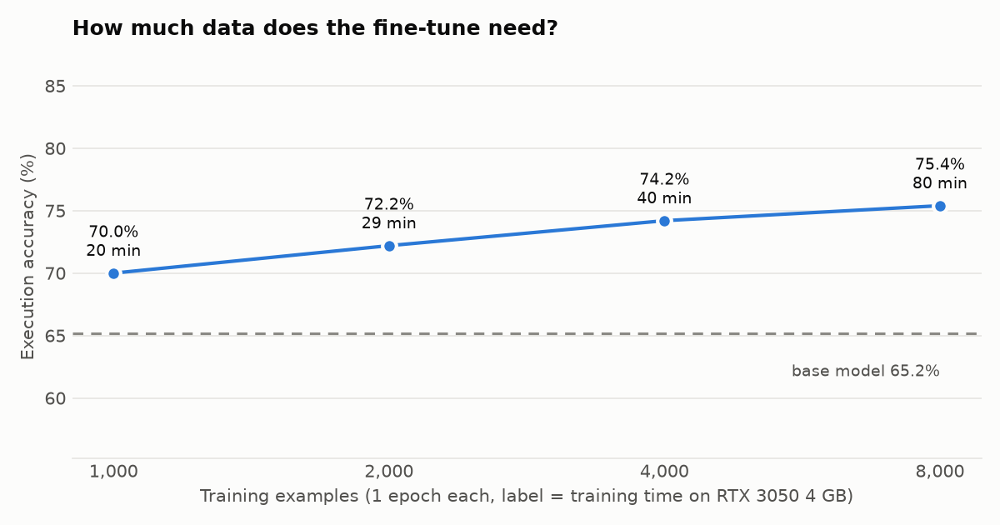
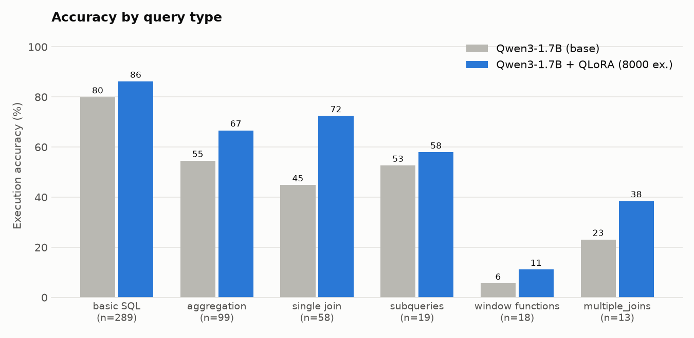

# Text-to-SQL on a 4 GB Laptop GPU

Fine-tuning **Qwen3-1.7B** with **QLoRA** to turn plain-English questions into SQLite queries. Training, evaluation and deployment (Ollama) all run on a single **RTX 3050 Laptop GPU with 4 GB of VRAM**.

```
> python demo/ask_db.py "Which 3 customers spent the most on delivered orders?"

SQL (3.3s):
  SELECT customers.name, SUM(order_items.quantity * products.price) as total_spent FROM customers
  JOIN orders ON customers.customer_id = orders.customer_id JOIN order_items ON orders.order_id = order_items.order_id
  JOIN products ON order_items.product_id = products.product_id WHERE orders.status = 'delivered'
  GROUP BY customers.name ORDER BY total_spent DESC LIMIT 3

  name  | total_spent
  ------+------------
  Hiro  | 15337.5
  Elena | 6432.0
  Jay   | 6277.5
```

The model writes `status = 'delivered'` (lowercase, as stored) because the prompt shows it example rows. The first version of this project, which saw only the table definitions, wrote `'Delivered'` and returned nothing (see [limitations](#limitations-and-next-steps)).

## Results

<!-- RESULTS:START -->
Execution accuracy on **500 held-out questions** from the dataset's test split (same prompt, greedy decoding):

| Model | Size | Execution accuracy | 95% CI | Valid SQL |
|---|---|---|---|---|
| Qwen3-1.7B (base) | 1.7B | 65.2% | 60.9–69.2% | 94.6% |
| Gemma 3 4B (Ollama) | 3.9B | 69.4% | 65.2–73.3% | 97.6% |
| **Qwen3-1.7B + QLoRA (8k examples)** | 1.7B | **75.4%** | 71.4–79.0% | 97.8% |
| **sql-qwen** (exported to Ollama, q8_0 GGUF) | 1.7B | **76.2%** | 72.3–79.7% | 97.8% |

* **+10.2 points over the base model**, and **6 points better than Gemma 3 4B**, a model more than twice the size. Both gains are statistically significant by McNemar's paired test on the same 500 questions (the fine-tuned model fixed 72 questions and broke 21 against the base model, p < 1e-6; it beat Gemma 55 to 25, p = 0.001).
* **The export to Ollama loses no accuracy** (75.4% → 76.2%, p = 0.5), so the shipped model matches the evaluated one.
* **Joins gain the most:** single-join accuracy rose from 45% to 72%, and multiple joins from 23% to 38%.
* **Data ablation:** 1k examples already get +4.8 points over the base model (about 20 minutes of training). Each doubling of the data adds about 1–2 points, and 4k vs 8k isn't significantly different (p = 0.4).
* **The prompt matters as much as the training.** Showing 3 example rows per table instead of only the table definitions lifted every model by about 12 points, from 63.8% to 75.4% for the fine-tuned one (same questions; it fixed 67 and broke 9, p < 1e-6). The first version of this project is kept in [results/v1_schema_only/](results/v1_schema_only/). Fine-tuning gave a similar gain on top of both prompts (+11.6 and +10.2 points).
* Whole pipeline (4 training runs, 7 evaluations, export) runs in about 6 hours on an RTX 3050 4 GB, with peak training VRAM of about 3.2–3.4 GB.




<!-- RESULTS:END -->

Full tables, confidence intervals and the data-validation breakdown are in [results/RESULTS.md](results/RESULTS.md).

## What this project does

1. **Builds a validated dataset.** It starts from [`gretelai/synthetic_text_to_sql`](https://huggingface.co/datasets/gretelai/synthetic_text_to_sql) (100k synthetic examples across 100 domains). Every example is **executed in SQLite**, and only examples whose schema, data and reference query all run and return rows are kept. About 20% of the reference queries fail in SQLite, so skipping this step would mean training on broken labels.
2. **Fine-tunes with QLoRA.** The base model is loaded in 4-bit NF4 and stays frozen. LoRA adapters (r=16, all attention and MLP projections, 17M trainable parameters, 1% of the model) are trained on the SQL answer only, with the prompt masked out of the loss. Peak memory is about 3.2 GB. The prompt shows each table's `CREATE` statement plus 3 example rows, so the model can see how values are really stored.
3. **Evaluates by execution, not string match.** A generated query counts as correct if it returns the same rows as the reference query on the example's own database: column order is ignored, and row order is checked only when the reference has `ORDER BY`. Every query runs on a fresh in-memory database with a 5-second timeout, so a bad prediction (even a `DROP TABLE`) can't affect grading. The grader has its own unit tests.
4. **Compares fairly.** The base Qwen3-1.7B, the fine-tuned model, and **Gemma 3 4B** (more than twice as large) all get the same prompt and greedy decoding on the same 500 held-out questions from the dataset's **test split**. A training-size ablation (1k → 8k examples) shows how results scale with data.
5. **Ships it.** The adapter is merged, converted to an 8-bit GGUF with llama.cpp, and served by Ollama. The exported model is re-evaluated, which checks that the conversion didn't lose accuracy. A small CLI lets you ask questions about any SQLite file.

```
dataset ─► SQLite validation ─► QLoRA training (4-bit, LoRA) ─► execution-accuracy eval ─► merge ─► GGUF q8_0 ─► Ollama ─► demo
            (01_prepare_data)        (02_train)                    (03_evaluate, 04_report)        (05_export)              (demo/ask_db)
```

## Engineering notes

Problems hit along the way, and how they were solved:

* **Broken labels in a popular dataset.** About 20% of the reference queries don't run in SQLite (ambiguous column names, MySQL-only functions), and a further ~10% return no rows. These were filtered by execution, and the drop counts are reported in [results/RESULTS.md](results/RESULTS.md).
* **Fitting into 4 GB of VRAM.** The run uses 4-bit NF4 with double quantization, gradient checkpointing, a paged 8-bit AdamW optimizer, batch size 1 with gradient accumulation of 8, and short prompts (3 example rows per table, values cut to 40 characters).
* **Qwen3's thinking mode.** Training and inference both use `enable_thinking=False`, so the model emits an empty `<think></think>` block and answers directly. Ollama ignores a Modelfile `TEMPLATE` when the GGUF has an embedded chat template, and the stock Qwen3 template switches thinking back on. The export therefore writes a chat template into the GGUF that matches training exactly.
* **Quantization on Windows.** This Ollama version can't quantize GGUF imports, and its safetensors quantizer needs MLX, which isn't available on Windows. llama.cpp's converter writes `q8_0` directly, giving about 1.8 GB that still fits in VRAM.
* **Training that silently got 4–8× slower.** On Windows, GPU memory that doesn't fit in 4 GB spills into system RAM instead of failing, so training keeps running, just slowly. It happened twice: first when an Ollama model shared the GPU, then, after adding sample rows to the prompt, because a few long examples (up to 487 tokens, against 279 before) made PyTorch reserve more memory than the card has. The fix was to skip the 1.25% of training examples over 288 tokens, which brought the peak back down and the speed back to about 4.7 s/step. The tell-tale signs were GPU utilization of about 25% and dedicated memory pinned at the limit.
* **A fair comparison.** The sample rows were added without changing which questions are used (selection is by schema-only length), and the base model and Gemma were re-run with the same new prompt, so every row in the table is measured the same way.
* **Grader correctness.** `ORDER BY` inside a window function or subquery doesn't make the result ordered, so only the outer query is checked. Floats are rounded, and duplicate rows count. All of this is covered by `tests/test_sqlutils.py`.

## Reproduce

Requirements: Windows or Linux, an NVIDIA GPU with at least 4 GB of VRAM, Python 3.11, and [Ollama](https://ollama.com) with `ollama pull gemma3:4b` for the comparison.

```powershell
py -3.11 -m venv .venv
.\.venv\Scripts\Activate.ps1
pip install torch --index-url https://download.pytorch.org/whl/cu126
pip install -r requirements.txt
python -c "import torch; print(torch.cuda.get_device_name())"   # must print your GPU

.\run_all.ps1      # everything, about 5-6 hours on an RTX 3050; logs in outputs/logs/
```

Or step by step:

```powershell
python -m pytest -q tests                              # grader unit tests
python scripts/01_prepare_data.py                      # validated train/val/eval sets
python scripts/02_train.py --train-size 8000           # -> outputs/adapters/n8000
python scripts/03_evaluate.py --model base             # or adapter:n8000, ollama:gemma3:4b
python scripts/05_export_to_ollama.py                  # -> `sql-qwen` in Ollama
python scripts/03_evaluate.py --model ollama:sql-qwen  # exported model keeps its accuracy?
python scripts/04_report.py                            # results/RESULTS.md + charts
python demo/ask_db.py                                  # interactive demo on a sample shop DB
python demo/ask_db.py --db path\to\your.db "How many orders per month?"
```

All settings (model, dataset sizes, LoRA and training hyperparameters) are in [config.py](config.py).

## Project structure

```
config.py                    all settings
sqlutils.py                  prompt format, SQLite execution, result comparison (shared by everything)
scripts/01_prepare_data.py   load + validate the dataset by execution
scripts/02_train.py          QLoRA fine-tuning (--train-size for the ablation)
scripts/03_evaluate.py       execution accuracy for base / adapter / any Ollama model
scripts/04_report.py         results/RESULTS.md + charts
scripts/05_export_to_ollama.py  merge -> GGUF -> ollama create
demo/ask_db.py               ask any SQLite database questions in English
tests/test_sqlutils.py       grader unit tests
run_all.ps1                  reproduce everything
results/                     committed metrics, charts and RESULTS.md
```

## Limitations and next steps

* **Synthetic data.** gretel's dataset is generated by an LLM, and its questions often hide value formats (for example `'WA'` vs `'Washington'`) that the model can only learn from the training data. The natural next benchmark is [Spider](https://yale-lily.github.io/spider) or [BIRD](https://bird-bench.github.io/), which use real databases.
* **Only 3 example rows per table.** They fix most value-format errors (the first version wrote `status = 'Delivered'` when the data had `'delivered'`), but a value that never appears in the first 3 rows can still be guessed wrong. Showing the distinct values of low-cardinality columns would go further.
* **Window functions remain weak** (2 of 18 correct), and only 3% of the training set uses them.
* **Ambiguous questions.** "Average order value per category" can reasonably be averaged per order line or per order, and the dataset's reference answers are sometimes debatable, so 100% isn't reachable.
* **Read-only queries.** INSERT/UPDATE/DELETE tasks are excluded because grading them needs a database-state comparison.

## Troubleshooting

| Problem | Fix |
|---|---|
| `CUDA out of memory` | Run `ollama ps` and stop any loaded model. If it still fails, set `MAX_SEQ_LENGTH = 384` or `LORA_R = 8` in `config.py`. |
| Training suddenly much slower (about 15+ s/step, GPU utilization around 25%) | Training memory spilled into system RAM, either because another program uses the GPU (close it, e.g. a game launcher) or because the process outgrew 4 GB. Stop and restart training; lower `TRAIN_MAX_TOKENS` or `SAMPLE_ROWS` in `config.py` if it comes back. |
| `torch.cuda.is_available()` is `False` | You installed the CPU build of PyTorch. Run `pip uninstall torch`, then reinstall it with the `--index-url` line above. |
| `ollama run sql-qwen` shows a `<think>` block | The GGUF still has Qwen3's stock template. Delete `outputs/merged/` and re-run step 5. |
