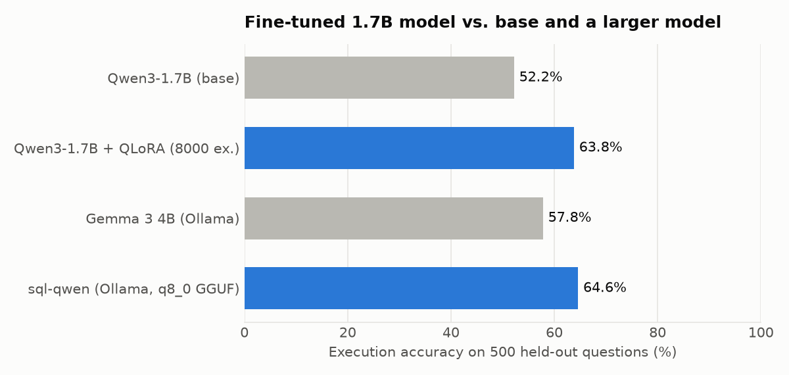
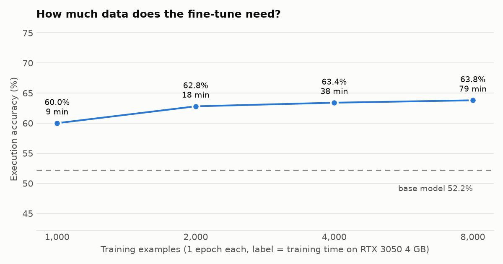
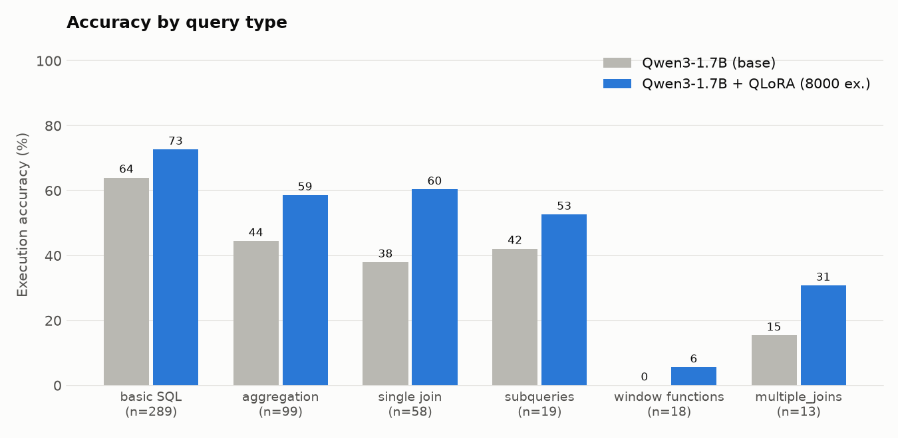

# Results

Execution accuracy on 500 held-out questions from the `gretelai/synthetic_text_to_sql` test split (validated in SQLite). 95% Wilson confidence intervals.

| Model | Execution accuracy | 95% CI | Valid SQL | Sec / question |
|---|---|---|---|---|
| Qwen3-1.7B (base) | **52.2%** | 47.8% – 56.5% | 92.0% | 0.445 |
| Qwen3-1.7B + QLoRA (8000 ex.) | **63.8%** | 59.5% – 67.9% | 97.6% | 0.639 |
| Gemma 3 4B (Ollama) | **57.8%** | 53.4% – 62.1% | 96.4% | 3.795 |
| sql-qwen (Ollama, q8_0 GGUF) | **64.6%** | 60.3% – 68.7% | 97.8% | 2.542 |
| finetuned-n1000 | **60.0%** | 55.6% – 64.2% | 95.4% | 0.842 |
| finetuned-n2000 | **62.8%** | 58.5% – 66.9% | 97.2% | 0.791 |
| finetuned-n4000 | **63.4%** | 59.1% – 67.5% | 97.4% | 0.742 |

## Training-data ablation

| Training examples | Execution accuracy | Val loss | Train time | Peak VRAM |
|---|---|---|---|---|
| 1,000 | 60.0% | 0.1676 | 9.2 min | 3.13 GB |
| 2,000 | 62.8% | 0.1557 | 17.9 min | 3.13 GB |
| 4,000 | 63.4% | 0.1457 | 37.6 min | 3.13 GB |
| 8,000 | 63.8% | 0.1388 | 79.4 min | 3.13 GB |

## By query type

## Data validation

Every candidate example was executed in SQLite; only examples whose schema, data and reference query all ran (and returned rows) were kept.

| Split | Examined | Kept | Dropped (reason: count) |
|---|---|---|---|
| train | 13,996 | 8,200 | reference SQL fails in SQLite: 2699, not a read-only task: 1455, reference SQL returns no rows: 1274, context fails in SQLite: 359, not a SELECT query: 9 |
| test | 888 | 500 | reference SQL fails in SQLite: 165, not a read-only task: 103, reference SQL returns no rows: 94, context fails in SQLite: 26 |
